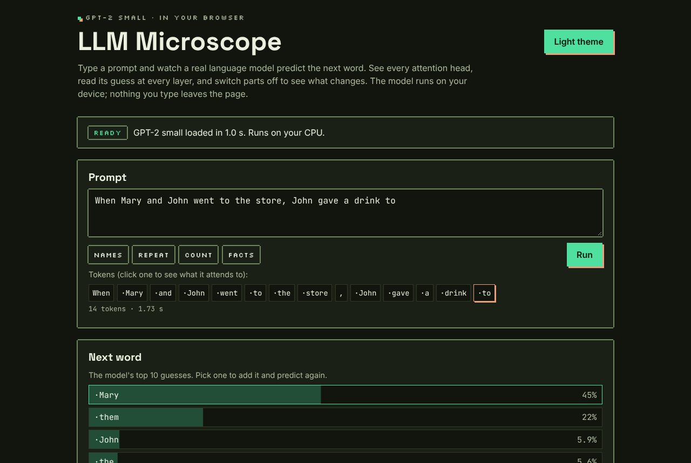
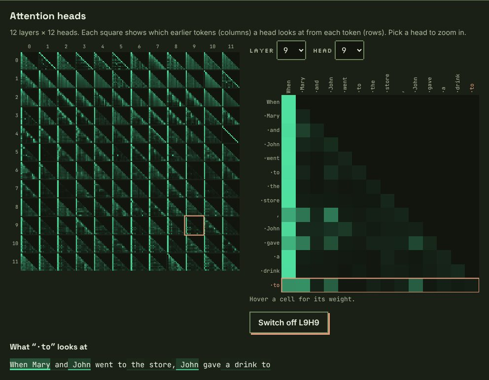
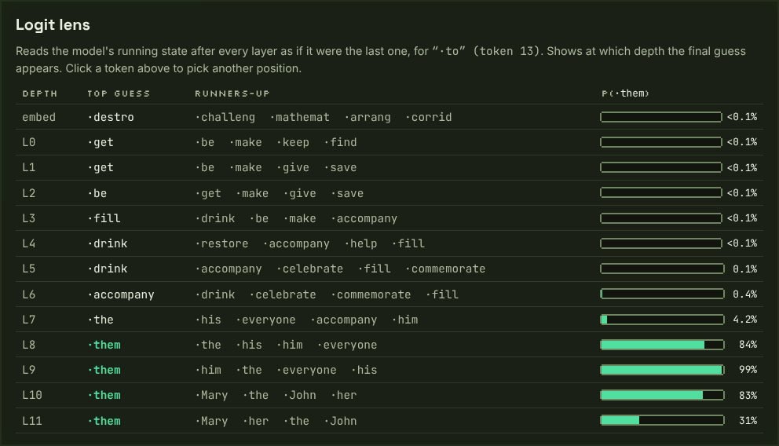
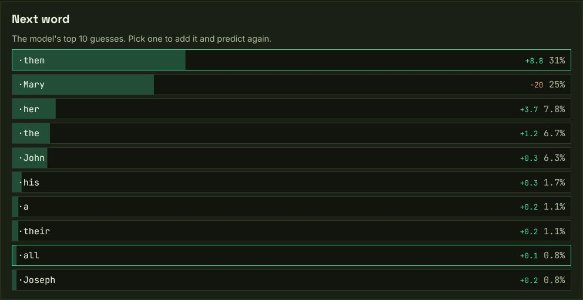
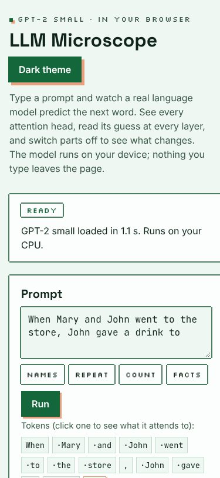

# LLM Microscope

Look inside a real language model running in your browser. Type a prompt and watch GPT-2 small predict the next word. See what each of its 144 attention heads looks at, read its guess at every layer (the logit lens), and switch heads off or steer it to see what changes.



Nothing to install and no server: the model runs in a Web Worker on your own device, and what you type never leaves the page.

## Use it
1. Open the site. The first visit downloads the model (129 MB) once; after that it loads from your browser's cache in a second or two.
2. Type a prompt or pick an example (Names, Repeat, Count, Facts), then press **Run** (or Ctrl/⌘+Enter).
3. **Next word** lists the model's top 10 guesses with probabilities. Click one to append it and predict again.
4. **Attention heads**: each small square is one head (rows = layers 0–11, columns = heads 0–11). Inside a square, row *i* shows which earlier tokens token *i* attends to. Click a square, or use the Layer/Head pickers, to zoom in. Click a token to see what it looks at.

5. **Interventions**: switch the selected head off (or use "Switch off name movers"), or steer the model by adding the difference between two phrases at one layer. The next-word list then shows each change in percentage points against the untouched run.
6. **Logit lens**: the model's best guess after every layer for the selected token, and how likely the final answer already is at that depth.

Try the default "Names" prompt with layer 9, head 9. It is one of the "name mover" heads found in GPT-2 small's indirect-object circuit (Wang et al. 2022), and from " to" it looks straight back at " Mary". Switch off the three name movers (L9H6, L9H9, L10H0) and " Mary" drops from 45% to 25%, and " them" takes over.

| Attention heads | Logit lens (name movers switched off) |
|---|---|
|  |  |

| Ablation deltas | Phone, light theme |
|---|---|
|  |  |

## How it works
- **Model**: OpenAI's GPT-2 small (124M parameters, 2019). The weights are converted to 8-bit (one scale per 64 weights) by `scripts/prepare-model.mjs` and split into files of 20 MiB or less, served from this site, checked with SHA-256 and cached with the Cache API.
- **Forward pass**: hand-written TypeScript (`src/model/gpt2.ts`), so every internal value is available: attention patterns, the residual stream at every layer, head switches (zero ablation) and steering (activation addition, Turner et al. 2023, averaged over each phrase's tokens and skipping the first position). It is tested against an independent numpy implementation (`scripts/reference.py`).
- **Tokenizer**: `gpt-tokenizer` (GPT-2's byte-pair encoding).

## Develop
Node 24, npm.
```bash
npm ci --ignore-scripts
npm run dev
npm run typecheck && npm run lint && npm test && npm run build && npm run test:e2e
```
First e2e run needs `npx playwright install chromium`, or set `PW_CHROMIUM_PATH` to an installed Chromium. To rebuild the weights: `npm run prepare-model` (downloads the 548 MB fp32 file from Hugging Face into `.cache/` once).

## Deploy
Cloudflare Pages via its Git integration: build `npm run build`, output `dist`, `NODE_VERSION=24`. `public/_headers` sets a strict CSP and long-term caching for the hashed model chunks.

## Secrets and network
No secrets, accounts or keys. At runtime the app fetches only from its own origin: the page, its scripts and fonts, and `/model/manifest.json` plus `/model/chunks/*.bin`. No analytics, no third-party hosts. It stores the model in the Cache API and the theme choice in `localStorage`.

## Licence and credits
Code: MIT (`LICENSE`). GPT-2 weights: © 2019 OpenAI, Modified MIT License (see `THIRD_PARTY_NOTICES.md`). Text shown as model output is generated by GPT-2, a small 2019 model that is often wrong and can reflect biases in its training data. The credits card art is all rights reserved (`NOTICE.md`).

Not affiliated with or endorsed by OpenAI.

Provided as is, no warranty.
